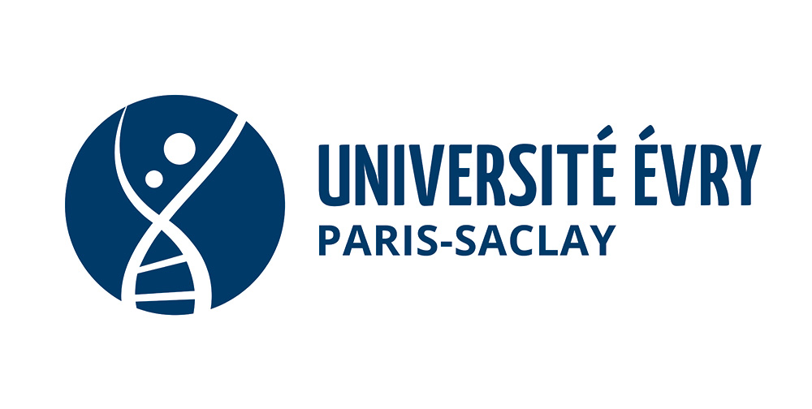

&nbsp;&nbsp;&nbsp;<b>×</b>&nbsp;&nbsp;&nbsp;
<picture>
  <source media="(prefers-color-scheme: dark)" srcset="assets/42-dark.svg">
  
</picture>

# Sami Hammouche

**Étudiant en informatique — Université Évry Paris-Saclay** 
**Piscine 42 Paris — août 2026**

---

## À propos

J'apprends en construisant. Je prends une notion, je l'implémente, je la casse, et je la refais jusqu'à ce qu'elle tienne — en général vers la troisième tentative.

Ce qui m'intéresse se situe entre les fondamentaux du logiciel et ce qui tourne en dessous : comprendre ce qui se passe près de la machine, puis en faire quelque chose d'utilisable.

## Mes projets

| Projet | Ce que c'est |
|---|---|
| [**windows-tweaks-manager**](https://github.com/iimass/windows-tweaks-manager) | Logiciel Python/tkinter qui applique une sélection de tweaks du registre Windows depuis une seule fenêtre, compilé en exécutable autonome |
| [**debian-ip-routing-lab**](https://github.com/iimass/debian-ip-routing-lab) | Routage IP statique entre deux réseaux sous Debian, avec une machine en routeur : configuration, `ip_forward` et analyse de trames |
| [**Town-Hall-Manager**](https://github.com/iimass/Town-Hall-Manager) | Application Java de gestion d'état civil : citoyens, naissances, décès, mariages et divorces, avec une interface Swing |
| [**42-piscine-paris-2026**](https://github.com/iimass/42-piscine-paris-2026) | Mes exercices de la piscine 42, en C et en shell, sans bibliothèque standard et à la Norme |
| [**2048-c**](https://github.com/iimass/2048-c) | Le jeu 2048 jouable dans le terminal, écrit en C |
| [**connect-four-c**](https://github.com/iimass/connect-four-c) | Un Puissance 4 dans le terminal, écrit en C |

## En ce moment

Réseau et systèmes sous Linux, programmation orientée objet en Java, et le C bas niveau de la piscine 42.

Build, break, understand, repeat.

